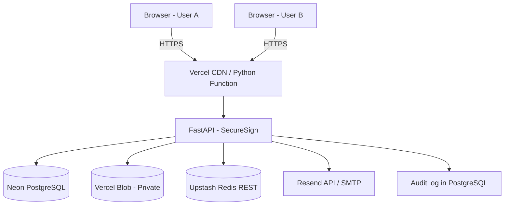
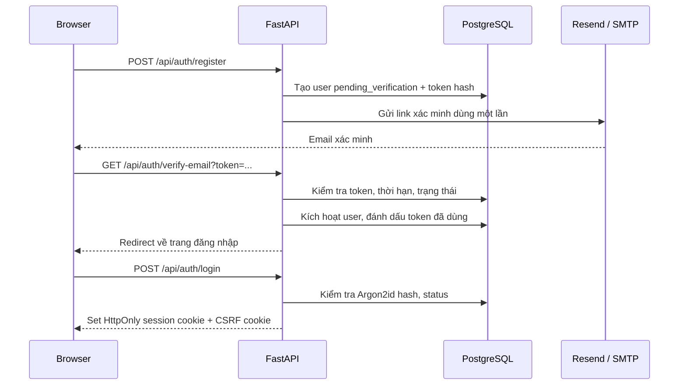
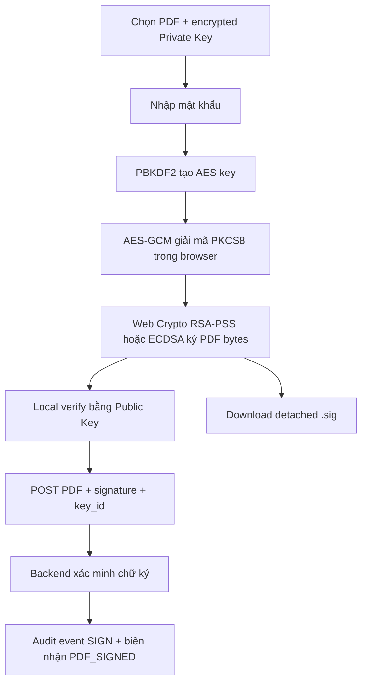

# SecureSign Cloud 2.1 — Kiến trúc hệ thống

## 1. Mục tiêu

SecureSign Cloud là ứng dụng web ký số PDF đa người dùng. Tài khoản tự đăng ký; mỗi người dùng quản lý khóa riêng, ký tài liệu, gửi cho tài khoản khác và xác thực chữ ký. Máy chủ quản lý danh tính tài khoản, Public Key, quyền truy cập tài liệu và nhật ký; Private Key dạng rõ không rời khỏi trình duyệt.

## 2. Kiến trúc triển khai Vercel

- Browser: HTML/CSS/JavaScript và Web Crypto API.
- Vercel: Python Runtime/Functions, HTTPS và CDN cho static assets.
- FastAPI: xác thực, phân quyền, quản lý khóa công khai, xác thực chữ ký, trao đổi tài liệu.
- PostgreSQL: dữ liệu tài khoản, phiên, khóa, quan hệ tin cậy, tài liệu, token email và audit log.
- Private file storage: PDF và `.sig`, không mount thành static/public path.
- Resend HTTPS API hoặc SMTP: xác minh email và đặt lại mật khẩu.

## 3. Mô hình dữ liệu

```mermaid
erDiagram
    USERS ||--o{ SESSIONS : owns
    USERS ||--o{ EMAIL_TOKENS : receives
    USERS ||--o{ PUBLIC_KEYS : registers
    USERS ||--o{ KEY_CHALLENGES : requests
    USERS ||--o{ TRUSTED_KEYS : trusts
    PUBLIC_KEYS ||--o{ TRUSTED_KEYS : trusted_by
    USERS ||--o{ DOCUMENTS : sends
    USERS ||--o{ DOCUMENTS : receives
    PUBLIC_KEYS ||--o{ DOCUMENTS : signs
    USERS ||--o{ EVIDENCE_ENTRIES : acts_in
    DOCUMENTS ||--o{ EVIDENCE_ENTRIES : recorded_by
    USERS ||--o{ AUDIT_LOGS : performs

    USERS {
      string id PK
      string email UK
      string full_name
      string password_hash
      string role
      string status
      datetime email_verified_at
    }
    SESSIONS {
      string id PK
      string user_id FK
      string token_hash UK
      string csrf_hash
      datetime expires_at
      datetime revoked_at
    }
    PUBLIC_KEYS {
      string id PK
      string owner_id FK
      string fingerprint UK
      text public_key_pem
      int key_size
      string status
    }
    TRUSTED_KEYS {
      string id PK
      string user_id FK
      string key_id FK
    }
    DOCUMENTS {
      string id PK
      string sender_id FK
      string recipient_id FK
      string key_id FK
      string file_name
      string pdf_path
      string signature_path
      string sha256
      string verification_status
    }
    AUDIT_LOGS {
      string id PK
      string actor_id FK
      string event_type
      string result
      datetime created_at
    }
```

### Quy tắc cô lập dữ liệu

- Mọi truy vấn lịch sử đều lọc theo `actor_id`.
- Danh sách khóa cá nhân lọc theo `owner_id`.
- Khóa công khai là dữ liệu có thể tra cứu; quan hệ đánh dấu tin cậy (`trusted_keys`) thuộc riêng từng người dùng.
- Tài liệu chỉ người gửi hoặc người nhận được truy cập. API tải file kiểm tra quyền ở Backend trước khi trả file.
- Admin quản lý tài khoản nhưng không có endpoint mặc định để đọc nội dung PDF riêng tư.
- Role của tài khoản đăng ký mới luôn là `user`; không nhận role từ payload đăng ký.

## 4. Luồng đăng ký và xác thực tài khoản

- Session token ngẫu nhiên, chỉ lưu SHA-256 hash trong database.
- Session cookie: HttpOnly, SameSite=Lax; Secure bật trong production.
- CSRF token gắn với session, gửi qua header `X-CSRF-Token` khi thay đổi dữ liệu.
- Email verification và password reset token được lưu dạng hash, có hạn dùng và chỉ dùng một lần.

## 5. Luồng tạo và đăng ký khóa

1. Trình duyệt tạo cặp RSA-PSS 2048-bit (exponent 65537) hoặc ECDSA P-256, theo lựa chọn của người dùng.
2. Private Key PKCS#8 được mã hóa bằng PBKDF2-HMAC-SHA-256 + AES-256-GCM.
3. Người dùng tải file Private Key đã mã hóa về thiết bị; Backend không nhận Private Key.
4. Trình duyệt yêu cầu challenge ngẫu nhiên từ Backend.
5. Trình duyệt ký challenge bằng Private Key; Backend xác minh proof-of-possession bằng Public Key.
6. Backend lưu Public Key và fingerprint, gắn `owner_id` với tài khoản hiện tại, và ghi biên nhận `KEY_REGISTERED` vào sổ bằng chứng.

## 6. Luồng ký PDF và xác thực

- RSA-PSS dùng SHA-256, MGF1-SHA-256 và salt 32 bytes; ECDSA dùng P-256 + SHA-256, chữ ký raw r||s được đổi sang DER trước khi gửi (OpenSSL đọc được).
- Thuật toán được xác định bởi Public Key đã đăng ký, không do client chọn.
- Máy chủ xác minh chữ ký và lưu lịch sử; không nhận Private Key.
- File `.sig` là chữ ký detached; PDF gốc không bị sửa hoặc nhúng chữ ký.

## 7. Luồng gửi và nhận tài liệu

1. Người gửi chọn email người nhận, Public Key của chính mình, PDF và `.sig`.
2. Backend kiểm tra người nhận đang hoạt động và khóa thuộc người gửi.
3. Backend xác minh chữ ký trên đúng byte PDF trước khi chấp nhận.
4. Backend lưu PDF và chữ ký trong private storage bằng tên UUID, không dùng tên do người dùng nhập làm đường dẫn.
5. Tạo document record liên kết `sender_id`, `recipient_id`, `key_id`.
6. Người nhận xem Inbox, tải file hoặc yêu cầu xác thực.
7. API tải file kiểm tra user hiện tại có phải sender hoặc recipient.

## 8. Bảo mật và giới hạn

- Password hashing: Argon2id.
- Session: opaque random token + hash at rest; logout/revoke được lưu phía server.
- CSRF: token kép cookie/header và kiểm tra hash session.
- Origin validation: kiểm tra Origin trên request thay đổi dữ liệu.
- Rate limit: dùng Upstash Redis REST trên Vercel để chia sẻ bộ đếm giữa các Function instance; local mode dùng bộ đếm trong process.
- Security headers: CSP, X-Content-Type-Options, X-Frame-Options, Referrer-Policy, Permissions-Policy, HSTS trong production.
- Local mode lưu file trong storage/; Vercel mode dùng private Vercel Blob, kiểm tra quyền sender/recipient trước khi đọc. PDF giới hạn 4 MiB trên Vercel do giới hạn request body 4.5 MB.
- Cần bổ sung quét mã độc, quota, backup/restore, MFA, monitoring, Redis rate limiting và kiểm thử xâm nhập trước khi public production.
- Không có CA chain, OCSP/CRL, TSA, PAdES hoặc xác minh danh tính pháp lý. `VALID` chỉ nói chữ ký mật mã khớp với dữ liệu và Public Key đã chọn.

## 9. Sổ bằng chứng chống chối bỏ (`backend/app/evidence.py`)

- Mỗi sự kiện `KEY_REGISTERED`, `KEY_REVOKED`, `PDF_SIGNED`, `DOCUMENT_SENT`, `DOCUMENT_VERIFIED` tạo một mục trong bảng `evidence_entries`: nội dung JSON chuẩn hóa (seq, thời gian máy chủ, người thực hiện, SHA-256 của PDF/chữ ký, fingerprint khóa, `prev_hash`), `entry_hash = SHA-256(nội dung)` và chữ ký ECDSA P-256 của máy chủ.
- Khóa ký biên nhận lấy từ `SECURESIGN_RECEIPT_KEY_PEM`, nếu không có thì được tạo một lần và lưu trong bảng `server_keys`.
- Thêm mục được tuần tự hóa bằng khóa trong tiến trình và `pg_advisory_xact_lock` trên PostgreSQL.
- `GET /api/receipts/{seq}` trả biên nhận cho người thực hiện, bên gửi/nhận tài liệu và admin; `POST /api/receipts/verify` kiểm tra chữ ký máy chủ và vị trí trong chuỗi; `GET /api/admin/evidence` kiểm tra toàn bộ chuỗi; `demos/verify_receipt.py` kiểm tra ngoại tuyến.
